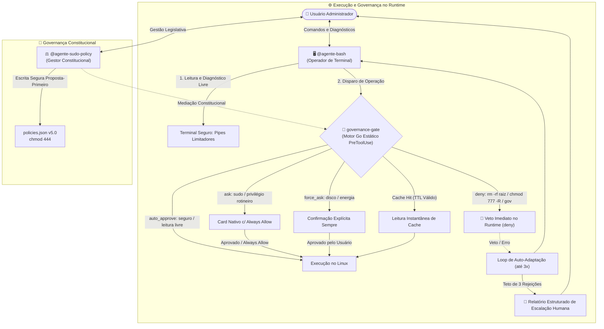

<div align="center">

# 🛡️ Antigravity Linux Governance
### *Agentes Autônomos de Terminal com Separação de Poderes, Motor Go Nativo, Auto-Approve, Auto-Compressão e Cache Local (v5.0.0)*

[](https://github.com/nickarab/bash-sudo-agents)
[](https://github.com/nickarab/bash-sudo-agents)
[](https://github.com/nickarab/bash-sudo-agents)
[](https://github.com/nickarab/bash-sudo-agents)
[](https://github.com/nickarab/bash-sudo-agents)
[](https://github.com/nickarab/bash-sudo-agents)
[-orange?style=for-the-badge)](https://github.com/nickarab/bash-sudo-agents)

<p align="center">
  <b>Um framework agêntico de alto desempenho que transforma o terminal Linux em um ambiente autônomo, governado no runtime e ultra-eficiente no consumo de tokens.</b>
</p>

<p align="center">
  <b>Camada de Governança Semântica, Guardrail em Runtime e Policy-as-Code</b> — não um sandbox de isolamento de kernel.
  <a href="#-escopo-e-limites-não-é-um-sandbox">Ver escopo e limites »</a>
</p>

[Instalação Rápida](#-instalação-express-em-nova-máquina) •
[Arquitetura](#-arquitetura-do-sistema) •
[Escopo & Limites](#-escopo-e-limites-não-é-um-sandbox) •
[Otimização de Tokens & Cache](#-otimização-de-tokens--cache-local) •
[Agentes](#-matriz-de-responsabilidades) •
[Constituição](#-mini-constituição-de-segurança-v50)

---

</div>

## 🌟 Destaques da Arquitetura

<table>
  <tr>
    <td width="50%">
      <h3>🛡️ Camada de Governança Semântica & Taxonomia Anti-Fadiga REAL</h3>
      Comandos seguros são emitidos como <code>auto_approve</code> (pula o card de aprovação padrão do host). Elevação rotineira usa <code>ask</code> (respeitando <i>Always Allow</i>), alto impacto usa <code>force_ask</code> e destruição real recebe <code>deny</code> via <code>governance-gate</code> (binário Go estático). <code>allow</code> fica reservado às ferramentas de escrita (review/diff nativo).
    </td>
    <td width="50%">
      <h3>⚡ Auto-Compressor Sintático de Tokens</h3>
      Injeção inteligente de limitadores na fonte (<code>head</code>, <code>tail</code>, <code>--no-pager</code>) via <code>overwrite</code> nativo. Blindagem sintática que respeita redirecionamentos e pipes existentes da IA.
    </td>
  </tr>
  <tr>
    <td width="50%">
      <h3>💾 Cache Local com TTL (Isolado 0700)</h3>
      Comandos estáticos de diagnóstico (<code>lscpu</code>, <code>uname</code>, <code>lspci</code>, <code>pacman -Ss</code> já comprimido) são cacheados em <code>/tmp/antigravity-gate-cache-&lt;uid&gt;</code> (permissão estrita <code>0700</code>) com escrita <b>atômica</b> (flock + tmp + <code>rename</code>).
    </td>
    <td width="50%">
      <h3>🔒 Zero Runtime Deps & Failsafe Universal</h3>
      Um único binário estático (<code>CGO_ENABLED=0</code>, sem Python, sem interpretador, sem <code>pip</code>). <em>Panic</em> interno vira <code>force_ask</code> por <code>recover</code>; stdout é byte-stream, então <b>não existe</b> erro de encoding em locale algum.
    </td>
  </tr>
  <tr>
    <td width="50%">
      <h3>🧱 Parser de Gramática (AST) em vez de Regex (v5.0.0)</h3>
      O comando é <b>parseado</b> (<code>mvdan.cc/sh/v3/syntax</code>) e as detecções operam sobre nós: <code>rm</code>/<code>find</code>/<code>shred</code>/<code>dd</code>, mutação direta (<code>mv</code>, <code>cp</code>, <code>truncate</code>, <code>tee</code>, <code>ln</code>, <code>sed -i</code>, <code>tar -x -C</code>, <code>rsync</code>, <code>1&gt;/etc/fstab</code>) e recursão em <code>bash -c</code>/<code>su -c</code>/heredoc. Interpretadores inline são desquotados e reanalisados.
    </td>
    <td width="50%">
      <h3>🚦 Fail-Closed, Governança por Caminho e Concorrência Correta</h3>
      Payload sem <code>CommandLine</code> reconhecível (e stdin vazio) vira <code>force_ask</code>. A proteção de governança é por caminho resolvido (<code>realpath</code> + pseudo-cwd de <code>cd</code> + symlinks). Estado de recusas e cache usam <code>flock</code> + <code>rename</code> atômico: sem <em>lost update</em> nem leitura truncada.
    </td>
  </tr>
</table>

---

## 🏗️ Arquitetura do Sistema



---

## ⚠️ Escopo e Limites (não é um sandbox)

Este projeto é uma **Camada de Governança Semântica / guardrail de autonomia** para agentes de LLM **cooperativos**. O objetivo é evitar acidentes, reduzir a fadiga de aprovações e economizar tokens — **não** é uma fronteira de isolamento de kernel nem um sandbox contra um agente hostil (jailbroken/injetado).

**O que ele garante:**

* Contenção consistente e auditável das operações de altíssimo risco (`rm -rf /`, `chmod -R 777 /etc`, formatação, energia, derrubada de sessão, edição dos arquivos de governança).
* Taxonomia de decisão previsível (`auto_approve` / `ask` / `force_ask` / `deny`, além de `allow` para escrita) e registro em `audit.log`.
* Execução sem fricção de comandos auditados e seguros: o motor emite `auto_approve` (o único valor do contrato do Antigravity que pula o card de aprovação padrão; `allow` apenas delega à política padrão).
* Compressão de saída na fonte e cache local com TTL, com estado concorrente correto (sem corrupção sob subagentes paralelos).

**O que ele NÃO garante:**

* Isolamento de processo, usuário, sistema de arquivos ou rede. Um comando que **não** case com as heurísticas (binários não cobertos, execução remota do tipo `curl | sh`, `bash arquivo.sh` com conteúdo malicioso) pode passar.
* Proteção contra engenharia social do LLM: aprovar **"Always Allow"** em um prompt `ask` de `sudo` libera as próximas elevações daquele recurso.

Se você precisa de isolamento real, combine este guardrail com `bubblewrap`/`firejail`, `systemd-run`/cgroups, usuário dedicado, montagens read-only e/ou containers.
---

## ⚡ Otimização de Tokens & Cache Local

O motor `governance-gate` atua ativamente para reduzir o consumo de tokens antes que qualquer texto seja gravado no histórico da sessão:

### 1. Auto-Compressor na Fonte
* **`journalctl`** ➔ Adiciona automaticamente `--no-pager -n 35`.
* **`dmesg`** ➔ Adiciona automaticamente `--color=never | tail -n 35`.
* **`git log`** ➔ Adiciona automaticamente `-n 15`.
* **`pacman -Ss` / `yay -Ss` / `paru -Ss`** ➔ Embute `| head -n 25` diretamente dentro do wrapper de cache.
* **Blindagem Sintática:** Se a IA já tiver configurado redirecionamentos (`>`, `>>`) ou pipes (`|`), o compressor não interfere. A regra só dispara quando o binário do `CallExpr` **é** o comando (fim dos falsos positivos de prefixo cru como `journalctl_evil`).

### 2. Cache com TTL (Time-To-Live)
* **Local:** `/tmp/antigravity-gate-cache-<uid>/` (permissão estrita `0700`, dono = uid efetivo)
* **Hardware/Distro Estático** (`lscpu`, `uname -a`, `lspci`, `lsusb`, `cat /etc/os-release`): TTL de **1 hora**.
* **Buscas em Repositórios** (`pacman -Ss`, `yay -Ss`): TTL de **10 minutos** (armazena a saída já truncada em 25 linhas).
* **Comandos Voláteis** (`git status`, `systemctl`, `ps`, testes): **TTL = 0** (nunca cacheados).
* **Escrita atômica:** a segunda fase é o subcomando `governance-gate cache-write` (lock `flock` + tmp `0600` + `fsync` + `rename`), substituindo o `tee` não atômico do motor legado. A leitura valida TTL pelo *timestamp no corpo* e confere o `sha256` do conteúdo.

---

## 👥 Matriz de Responsabilidades

| Componente | Identidade | Nível de Acesso | Diretiva Primária |
| :--- | :--- | :--- | :--- |
| **`@agente-bash`** | **Operador de Terminal** (LLM) | Leitura irrestrita do SO / Shell sem privilégios | Executa diagnósticos ágeis, compacta saídas na fonte e conduz comandos no terminal. Mantém sessão contínua (*Modo Sticky*). |
| **`governance-gate`** | **Motor de Runtime** (Binário Go / Hook SO) | Interceptador nativo `PreToolUse` no SO | Aplica em runtime as regras (RULE-02 a RULE-15), veto sumário a destruição (`deny`), retenção de alto impacto (`force_ask`), elevação com *Always Allow* (`ask`), **auto-aprovação de comandos seguros (`auto_approve`)**, auto-compressão e cache com TTL. Fail-closed em schema desconhecido e em stdin vazio. |
| **`@agente-sudo-policy`** | **Gestor Constitucional** (LLM) | Monopólio legislativo exclusivo | Detém o monopólio exclusivo de legislar sobre as regras em `policies.json`, `meta_policies.json`, `AGENTS.md` e `hooks.json`. Segue o *Rito Proposta-Primeiro*. |

---

## 📡 Contrato de Runtime do Motor PreToolUse

O motor `governance-gate` opera como camada de governança interceptando cada chamada de ferramenta enviada pelo Antigravity:

### 📥 Entrada (Stdin: Payload do Antigravity)
```json
{
  "toolCall": {
    "name": "run_command",
    "args": {
      "CommandLine": "systemctl restart bluetooth.service",
      "Cwd": "/home/user"
    }
  },
  "stepIdx": 1
}
```

### 📤 Saída (Stdout: Deliberação do Motor no Runtime)
```json
{
  "decision": "auto_approve | allow | ask | force_ask | deny",
  "reason": "Justificativa constitucional ou aviso de retenção (force_ask)",
  "overwrite": {
    "CommandLine": "comando otimizado ou redirecionado para cache"
  }
}
```

| `decision` | Efeito no Antigravity |
| :--- | :--- |
| `auto_approve` | **Aprova automaticamente** quando a política padrão promptaria — usado para comandos auditados e seguros, compressão e cache (zero fricção). |
| `allow` | Apenas **delega** à política padrão do host (usado para ferramentas de escrita, que mostram o diff/review nativo). |
| `ask` | Prompt com **"Always Allow"** (elevação rotineira). |
| `force_ask` | Prompt **sempre** (disco, energia, governança). |
| `deny` | Bloqueio imediato (destruição real, governança). |

> **Matcher:** o hook é registrado com `"matcher": "*"` para auditar também os
> alvos (`TargetFile`) de ferramentas de escrita/edição. Ferramentas de leitura
> conhecidas recebem `auto_approve`; as de escrita, `allow`; e qualquer schema
> desconhecido cai em `force_ask` (fail-closed).

---

## ⚖️ Mini Constituição de Segurança (`v5.0`)

As diretrizes do sistema residem em [`security/policies.json`](security/policies.json) e são fiscalizadas ativamente em tempo de execução pelo binário Go `governance-gate`:

<details open>
<summary><b>🔍 Clique para expandir os 15 Artigos Constitucionais</b></summary>
<br>

| Código | Nome da Regra | Severidade | Efeito Prático | Fiscalização |
| :---: | :--- | :---: | :--- | :---: |
| **`RULE-01`** | **Soberania do Display** | `CRITICAL` | Edição/escrita de `monitors.lua` exige confirmação humana. *(v5.0.0: saiu do escopo do motor de runtime.)* | Diretriz Constitucional |
| **`RULE-02`** | **Anti-Destruição** | `CRITICAL` | Bloqueio de deleção recursiva indiscriminada na raiz (`/`) e em diretórios vitais (`/boot`, `/etc`, `/root`, `/opt`, `/srv`, `/mnt`, ...). Cobre também mutação direta (`mv`, `cp`, `truncate`, `tee`, `ln`, `sed -i`, `tar -x -C`, `rsync`, `>`/`>>` incl. `1>/etc`), recursão em `bash -c`/`su -c` e interpretadores inline. Symlink para vital é resolvido. Alvo com `$VAR` não resolvido vira `force_ask`; limpeza de `/var/log` vira `ask`. | **Hook `deny` sumário** |
| **`RULE-03`** | **Operações de Disco** | `CRITICAL` | Comandos `mkfs`, `fdisk`, `cryptsetup`, `dd` exigem alvo explícito e blindam partições ativas (`/`, `/boot`). | **Hook `force_ask`** |
| **`RULE-04`** | **Escopo Estrito** | `HIGH` | O comando com privilégio deve ater-se exclusivamente à necessidade da tarefa solicitada. | `governance-gate` |
| **`RULE-05`** | **Preservação de Permissões** | `HIGH` | Veto semântico a permissões recursivas abusivas (`chmod -R 777`, `chmod 777 -R`, `a+w` ou `chown -R` no sistema). | **Hook `deny`** |
| **`RULE-06`** | **Sigilo de Credenciais** | `HIGH` | Enforce de `HISTFILE=/dev/null`. Descontinuação e veto permanente a runners com senhas locais. | **Hook `deny`** |
| **`RULE-07`** | **Anti-Crash & Energia** | `HIGH` | Proibido derrubar/reiniciar sessão gráfica (`deny`); `reboot`/`poweroff`/`suspend` exigem confirmação (`force_ask`). | **Hook `deny` / `force_ask`** |
| **`RULE-08`** | **Mitigação Ativa** | `MEDIUM` | Remodelação autônoma orientada pelo parecer técnico de veto sem transferir ruído ao usuário. | Loop Auto-Adaptação |
| **`RULE-09`** | **Franquia de Diagnóstico** | `INFO` | Acesso instantâneo e livre para ler métricas, sensores, hardware e logs da máquina. | Execução Livre (`auto_approve`) |
| **`RULE-10`** | **Regra 3X (Teto de Recusas)** | `CRITICAL` | Limite de 3 rejeições consecutivas. Na 3ª recusa, suspensão imediata e alerta de escalação. Estado serializado por `flock` (sem *lost update*). | Loop Auto-Adaptação (3X) |
| **`RULE-11`** | **Monopólio Legislativo** | `CRITICAL` | Exclusividade legislativa do `@agente-sudo-policy`. Veto de escrita nos caminhos de governança. | **Hook `deny`** |
| **`RULE-12`** | **Blindagem de Governança** | `CRITICAL` | Arquivos e `hooks.json` mantidos em `chmod 444`, protegidos por `deny` no hook `PreToolUse` (`governance-gate`). A checagem é por **caminho resolvido** (`realpath` + pseudo-cwd de `cd` + symlinks). | **Hook `deny`** |
| **`RULE-13`** | **Modo Sticky Automático** | `MANDATORY` | O `@agente-bash` assume a sessão contínua até saída explícita ou invocação de outro agente. | Sessão Contínua |
| **`RULE-14`** | **Rito Proposta-Primeiro** | `CRITICAL` | Propostas de regras geram apenas texto no chat; modificações em disco exigem autorização expressa. | **Hook + Política** |
| **`RULE-15`** | **Taxonomia Privilegiada** | `HIGH` | Elevação rotineira (`sudo`, `sudoedit`, `doas`, `pkexec`, `su`, `run0`, `yay/pacman -S*`) com suporte a *Always Allow*. | **Hook `ask`** |

</details>

---

## 🚀 Instalação Express em Nova Máquina

Para replicar todo o ecossistema em qualquer máquina Linux (requer apenas o toolchain **Go 1.22+** para compilar o binário estático — **zero Python**, zero `pip`):

```bash
# 1. Clonar o repositório
git clone git@github.com:nickarab/bash-sudo-agents.git
cd bash-sudo-agents

# 2. Executar o instalador automatizado
./install.sh
```

### O que o instalador faz automaticamente:
* 📁 Cria as estruturas em `~/.gemini/config/plugins/bash-sudo-agents` e `~/.gemini/antigravity/scratch/security`.
* 💾 Realiza **backup atômico** com timestamp das instalações anteriores (plugin, políticas e agentes) em `~/.gemini/antigravity/scratch/backups/`.
* 📦 Instala as Skills e as Regras Constitucionais (`AGENTS.md`).
* 🚧 Compila o binário Go estático (`CGO_ENABLED=0`, `-trimpath -ldflags="-s -w"`), instala-o de forma atômica (`tmp` + `rename`, `chmod 0755`), registra o `hooks.json` via `governance-gate render-hooks` (sem `sed`/`jq`/Python) e executa o **smoke test** (comando seguro + fail-closed de stdin vazio).
* 🔒 Aplica isolamento de leitura estrita (`chmod 444`) em todos os arquivos de governança.

---

## 🧪 Suíte de Testes e Validação

O framework é validado por:

* **158 casos table-driven** do avaliador (`pkg/evaluator/rules_test.go`), port 1:1 do corpus Python v4.5.0.
* **Corpus golden de integração** (`cmd/governance-gate/testdata/cases.jsonl`) — executa o binário real para cada caso e compara decisão e `overwrite` injetado.
* Testes unitários por pacote: `shparse` (AST), `pathx` (traversal/symlink/ELOOP), `state` (concorrência: contador exato), `cache` (TTL, atomicidade, chave por locale).

```bash
# Suíte completa
go test ./...

# Concorrência correta (detector de corrida)
go test -race ./...

# Análise estática
go vet ./...
```

---

## 📂 Árvore de Diretórios

```text
bash-sudo-agents/
├── 📄 .gitignore                  # Proteção contra vazamento de arquivos locais
├── ⚙️ install.sh                  # Instalador universal (build Go + backup atômico)
├── 📘 README.md                   # Esta documentação executiva
├── 📝 CHANGELOG.md                # Histórico de versões (v5.0.0)
├── 🐹 go.mod / go.sum             # Módulo Go (mvdan.cc/sh/v3 para o parser de shell)
├── 🧩 cmd/governance-gate/        # 🌟 Motor Go: hook PreToolUse + subcomandos
│   ├── main.go                    #    (cache-write, render-hooks, version)
│   ├── integration_test.go        #    Testes de ponta a ponta + corpus golden
│   └── testdata/cases.jsonl       #    Corpus golden (1 caso por linha)
├── 📦 pkg/
│   ├── shparse/                   # Parser de shell -> AST normalizada (argv + redirects)
│   ├── evaluator/                 # Auditoria constitucional (RULE-02..15)
│   ├── pathx/                     # Resolução de caminhos (vitais, gov, symlinks)
│   ├── cache/                     # Cache TTL com escrita atômica
│   ├── state/                     # Contador 3X (flock + rename)
│   ├── compress/                  # Auto-compressor sintático
│   ├── audit/                     # audit.log JSONL
│   ├── contract/                  # Contrato de entrada/saída e taxonomia
│   └── policy/                    # Listas de vitais (go:embed) e conjuntos de regras
├── 🧩 plugin/
│   ├── plugin.json                # Manifesto oficial do plugin Antigravity (v5.0.0)
│   ├── hooks.json                 # Template do hook (`__GATE_PATH__` -> caminho absoluto na instalação)
│   ├── agents/                    # Agentes nativos declarados no ecossistema Antigravity
│   │   ├── agente-bash.md         # Agente nativo: Operador de Terminal
│   │   └── agente-sudo-policy.md  # Agente nativo: Gestor Constitucional
│   ├── rules/
│   │   └── AGENTS.md              # Mini Constituição injetada no prompt do sistema
│   └── skills/
│       ├── agente-bash/
│       │   └── SKILL.md           # Definição e rotina operacional do Operador
│       └── agente-sudo-policy/
│           └── SKILL.md           # Diretivas e procedimentos do Gestor Constitucional
└── 🔐 security/
    ├── policies.json              # Políticas constitucionais ativas (v5.0)
    ├── meta_policies.json         # Políticas de autodefesa e metagovernança
    ├── agents_manifest.json       # Manifesto de integridade de agentes
    └── README.md                  # Guia de segurança e procedimentos de backup
```

---

<div align="center">

Desenvolvido para máxima segurança, produtividade e confiabilidade operacional no **Antigravity**.  
*Zero dependências em runtime • Zero vazamento de contexto • 100% Autonomia auditada no runtime.*

</div>
