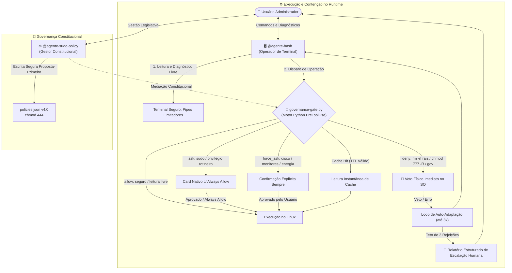

<div align="center">

# 🛡️ Antigravity Linux Governance
### *Agentes Autônomos de Terminal com Separação de Poderes, Motor Python Nativo, Auto-Compressão e Cache Local (v4.4.0)*

[](https://github.com/nickarab/bash-sudo-agents)
[](https://github.com/nickarab/bash-sudo-agents)
[](https://github.com/nickarab/bash-sudo-agents)
[](https://github.com/nickarab/bash-sudo-agents)
[](https://github.com/nickarab/bash-sudo-agents)
[](https://github.com/nickarab/bash-sudo-agents)
[-orange?style=for-the-badge)](https://github.com/nickarab/bash-sudo-agents)

<p align="center">
  <b>Um framework agêntico de alto desempenho que transforma o terminal Linux em um ambiente autônomo, blindado no runtime e ultra-eficiente no consumo de tokens.</b>
</p>

[Instalação Rápida](#-instalação-express-em-nova-máquina) •
[Arquitetura](#-arquitetura-do-sistema) •
[Otimização de Tokens & Cache](#-otimização-de-tokens--cache-local) •
[Agentes](#-matriz-de-responsabilidades) •
[Constituição](#-mini-constituição-de-segurança-v40)

---

</div>

## 🌟 Destaques da Arquitetura

<table>
  <tr>
    <td width="50%">
      <h3>🛡️ Dupla Barreira & Taxonomia Anti-Fadiga</h3>
      O operador de terminal (<code>@agente-bash</code>) é orientado por princípios estritos. Elevação rotineira usa <code>ask</code> (respeitando <i>Always Allow</i>), alto impacto usa <code>force_ask</code> e destruição real recebe <code>deny</code> via <code>governance-gate.py</code>.
    </td>
    <td width="50%">
      <h3>⚡ Auto-Compressor Sintático de Tokens</h3>
      Injeção inteligente de limitadores na fonte (<code>head</code>, <code>tail</code>, <code>--no-pager</code>) via <code>overwrite</code> nativo. Blindagem sintática que respeita redirecionamentos e pipes existentes da IA.
    </td>
  </tr>
  <tr>
    <td width="50%">
      <h3>💾 Cache Local com TTL (Isolado 0700)</h3>
      Comandos estáticos de diagnóstico (<code>lscpu</code>, <code>uname</code>, <code>lspci</code>, <code>pacman -Ss</code> já comprimido) são cacheados localmente com TTL configurável em diretório restrito (<code>0700</code>).
    </td>
    <td width="50%">
      <h3>🔒 Zero-Pip & Failsafe Universal</h3>
      Construído estritamente com a biblioteca padrão do Python 3.8+ (sem necessidade de <code>pip install</code> ou <code>jq</code>). Envelopamento global com <code>try/except</code> que impede travamentos da IDE.
    </td>
  </tr>
</table>

---

## 🏗️ Arquitetura do Sistema



---

## ⚡ Otimização de Tokens & Cache Local

O motor `governance-gate.py` atua ativamente para reduzir o consumo de tokens antes que qualquer texto seja gravado no histórico da sessão:

### 1. Auto-Compressor na Fonte
* **`journalctl`** ➔ Adiciona automaticamente `--no-pager -n 35`.
* **`dmesg`** ➔ Adiciona automaticamente `--color=never | tail -n 35`.
* **`git log`** ➔ Adiciona automaticamente `-n 15`.
* **`pacman -Ss` / `yay -Ss` / `paru -Ss`** ➔ Embute `| head -n 25` diretamente dentro do wrapper de cache.
* **Blindagem Sintática:** Se a IA já tiver configurado redirecionamentos (`>`, `>>`) ou pipes (`|`), o compressor não interfere, garantindo integridade sintática.

### 2. Cache com TTL (Time-To-Live)
* **Local:** `~/.cache/antigravity/bash_agents/` (permissão estrita `0700`)
* **Hardware/Distro Estático** (`lscpu`, `uname -a`, `lspci`, `lsusb`, `cat /etc/os-release`): TTL de **1 hora**.
* **Buscas em Repositórios** (`pacman -Ss`, `yay -Ss`): TTL de **10 minutos** (armazena a saída já truncada em 25 linhas).
* **Comandos Voláteis** (`git status`, `systemctl`, `ps`, testes): **TTL = 0** (nunca cacheados).

---

## 👥 Matriz de Responsabilidades

| Componente | Identidade | Nível de Acesso | Diretiva Primária |
| :--- | :--- | :--- | :--- |
| **`@agente-bash`** | **Operador de Terminal** (LLM) | Leitura irrestrita do SO / Shell sem privilégios | Executa diagnósticos ágeis, compacta saídas na fonte e conduz comandos no terminal. Mantém sessão contínua (*Modo Sticky*). |
| **`governance-gate.py`** | **Motor de Runtime** (Hook SO) | Interceptador nativo `PreToolUse` no SO | Aplica fisicamente as regras (RULE-01 a RULE-15), veto sumário a destruição (`deny`), retenção de alto impacto (`force_ask`), elevação com *Always Allow* (`ask`), auto-compressão e cache com TTL. |
| **`@agente-sudo-policy`** | **Gestor Constitucional** (LLM) | Monopólio legislativo exclusivo | Detém o monopólio exclusivo de legislar sobre as regras em `policies.json`, `meta_policies.json`, `AGENTS.md` e `hooks.json`. Segue o *Rito Proposta-Primeiro*. |

---

## 📡 Contrato de Runtime do Motor PreToolUse

O motor `governance-gate.py` opera como barreira física interceptando cada chamada de ferramenta enviada pelo Antigravity:

### 📥 Entrada (Stdin: Payload do Antigravity)
```json
{
  "toolCall": {
    "name": "run_command",
    "args": {
      "CommandLine": "systemctl restart bluetooth.service",
      "Cwd": "/home/user"
    }
  },
  "stepIdx": 1
}
```

### 📤 Saída (Stdout: Deliberação Física do Motor)
```json
{
  "decision": "allow | ask | force_ask | deny",
  "reason": "Justificativa constitucional ou aviso de contenção física",
  "overwrite": {
    "CommandLine": "comando otimizado ou redirecionado para cache"
  }
}
```

---

## ⚖️ Mini Constituição de Segurança (`v4.0`)

As diretrizes do sistema residem em [`security/policies.json`](security/policies.json) e são fiscalizadas ativamente em tempo de execução pelo motor Python `governance-gate.py`:

<details open>
<summary><b>🔍 Clique para expandir os 15 Artigos Constitucionais</b></summary>
<br>

| Código | Nome da Regra | Severidade | Efeito Prático | Fiscalização |
| :---: | :--- | :---: | :--- | :---: |
| **`RULE-01`** | **Soberania do Display** | `CRITICAL` | Leitura de `monitors.lua` é livre (`allow`); edição/escrita exige confirmação humana. | **Hook `force_ask`** |
| **`RULE-02`** | **Anti-Destruição** | `CRITICAL` | Bloqueio de deleção recursiva indiscriminada na raiz (`/`) e em diretórios vitais (`/boot`, `/etc`, etc.). | **Hook `deny` sumário** |
| **`RULE-03`** | **Operações de Disco** | `CRITICAL` | Comandos `mkfs`, `fdisk`, `cryptsetup`, `dd` exigem alvo explícito e blindam partições ativas (`/`, `/boot`). | **Hook `force_ask`** |
| **`RULE-04`** | **Escopo Estrito** | `HIGH` | O comando com privilégio deve ater-se exclusivamente à necessidade da tarefa solicitada. | `governance-gate` |
| **`RULE-05`** | **Preservação de Permissões** | `HIGH` | Veto semântico a permissões recursivas abusivas (`chmod -R 777`, `chmod 777 -R`, `a+w` ou `chown -R` no sistema). | **Hook `deny`** |
| **`RULE-06`** | **Sigilo de Credenciais** | `HIGH` | Enforce de `HISTFILE=/dev/null`. Descontinuação e veto permanente a runners com senhas locais. | **Hook `deny`** |
| **`RULE-07`** | **Anti-Crash & Energia** | `HIGH` | Proibido derrubar/reiniciar sessão gráfica (`deny`); `reboot`/`poweroff`/`suspend` exigem confirmação (`force_ask`). | **Hook `deny` / `force_ask`** |
| **`RULE-08`** | **Mitigação Ativa** | `MEDIUM` | Remodelação autônoma orientada pelo parecer técnico de veto sem transferir ruído ao usuário. | Loop Auto-Adaptação |
| **`RULE-09`** | **Franquia de Diagnóstico** | `INFO` | Acesso instantâneo e livre para ler métricas, sensores, hardware e logs da máquina. | Execução Livre |
| **`RULE-10`** | **Regra 3X (Teto de Recusas)** | `CRITICAL` | Limite de 3 rejeições consecutivas. Na 3ª recusa, suspensão imediata e alerta de escalação. | Loop Auto-Adaptação (3X) |
| **`RULE-11`** | **Monopólio Legislativo** | `CRITICAL` | Exclusividade legislativa do `@agente-sudo-policy`. Veto de escrita nos caminhos de governança. | **Hook `deny`** |
| **`RULE-12`** | **Blindagem de Governança** | `CRITICAL` | Arquivos e `hooks.json` mantidos em `chmod 444`, protegidos por `deny` no hook `PreToolUse` (`governance-gate.py`). | **Hook `deny`** |
| **`RULE-13`** | **Modo Sticky Automático** | `MANDATORY` | O `@agente-bash` assume a sessão contínua até saída explícita ou invocação de outro agente. | Sessão Contínua |
| **`RULE-14`** | **Rito Proposta-Primeiro** | `CRITICAL` | Propostas de regras geram apenas texto no chat; modificações em disco exigem autorização expressa. | **Hook + Política** |
| **`RULE-15`** | **Taxonomia Privilegiada** | `HIGH` | Elevação rotineira (`sudo`, `sudoedit`, `doas`, `pkexec`, `su`, `run0`, `yay/pacman -S*`) com suporte a *Always Allow*. | **Hook `ask`** |

</details>

---

## 🚀 Instalação Express em Nova Máquina

Para replicar todo o ecossistema em qualquer máquina Linux em segundos (requer apenas Python 3.8+ padrão, **zero pip**):

```bash
# 1. Clonar o repositório
git clone git@github.com:nickarab/bash-sudo-agents.git
cd bash-sudo-agents

# 2. Executar o instalador automatizado
./install.sh
```

### O que o instalador faz automaticamente:
* 📁 Cria as estruturas em `~/.gemini/config/plugins/bash-sudo-agents` e `~/.gemini/antigravity/scratch/security`.
* 💾 Realiza **backup atômico** com timestamp de qualquer instalação anterior em `~/.gemini/antigravity/scratch/backups/`.
* 📦 Instala as Skills e as Regras Constitucionais (`AGENTS.md`).
* 🚧 Instala e registra o motor Python `governance-gate.py` (`PreToolUse`) em `hooks.json` com `chmod 555`.
* 🔒 Aplica isolamento de leitura estrita (`chmod 444`) em todos os arquivos de governança.

---

## 🧪 Suíte de Testes e Validação

O framework conta com **183 verificações automatizadas** cobrindo injeção de comandos, recursão destrutiva, taxonomia `ask`/`force_ask`/`deny`, caminhos de governança, permissões semânticas e compressão:

```bash
# 1. Executar verificador rápido de bypass e regressão (83 testes Zero-Pip / Stdlib pura)
python3 tests/verify_fixes.py

# 2. Executar suíte completa de testes unitários (100 testes via pytest)
pytest tests/test_governance_gate.py
```

---

## 📂 Árvore de Diretórios

```text
bash-sudo-agents/
├── 📄 .gitignore                  # Proteção contra vazamento de arquivos locais
├── ⚙️ install.sh                  # Instalador universal automatizado com backup atômico
├── 📘 README.md                   # Esta documentação executiva
├── 🧪 tests/                      # Suíte de testes automatizados (183 verificações)
│   ├── test_governance_gate.py    # 100 testes unitários (pytest)
│   └── verify_fixes.py            # 83 testes de segurança sem dependências externas
├── 🧩 plugin/
│   ├── plugin.json                # Manifesto oficial do plugin Antigravity (v4.4.0)
│   ├── hooks.json                 # Registro do hook chamando python3 ./hooks/governance-gate.py
│   ├── agents/                    # Agentes nativos declarados no ecossistema Antigravity
│   │   ├── agente-bash.md         # Agente nativo: Operador de Terminal
│   │   └── agente-sudo-policy.md  # Agente nativo: Gestor Constitucional
│   ├── hooks/
│   │   └── governance-gate.py     # 🌟 Motor Python: Firewall Semântico, Cache TTL e Auto-Compressor
│   ├── rules/
│   │   └── AGENTS.md              # Mini Constituição injetada no prompt do sistema
│   └── skills/
│       ├── agente-bash/
│       │   └── SKILL.md           # Definição e rotina operacional do Operador
│       └── agente-sudo-policy/
│           └── SKILL.md           # Diretivas e procedimentos do Gestor Constitucional
└── 🔐 security/
    ├── policies.json              # Políticas constitucionais ativas (v4.0)
    ├── meta_policies.json         # Políticas de autodefesa e metagovernança
    ├── agents_manifest.json       # Manifesto de integridade de agentes
    └── README.md                  # Guia de segurança e procedimentos de backup
```

---

<div align="center">

Desenvolvido para máxima segurança, produtividade e confiabilidade operacional no **Antigravity**.  
*Zero dependências externas • Zero vazamento de contexto • 100% Autonomia auditada no runtime.*

</div>
