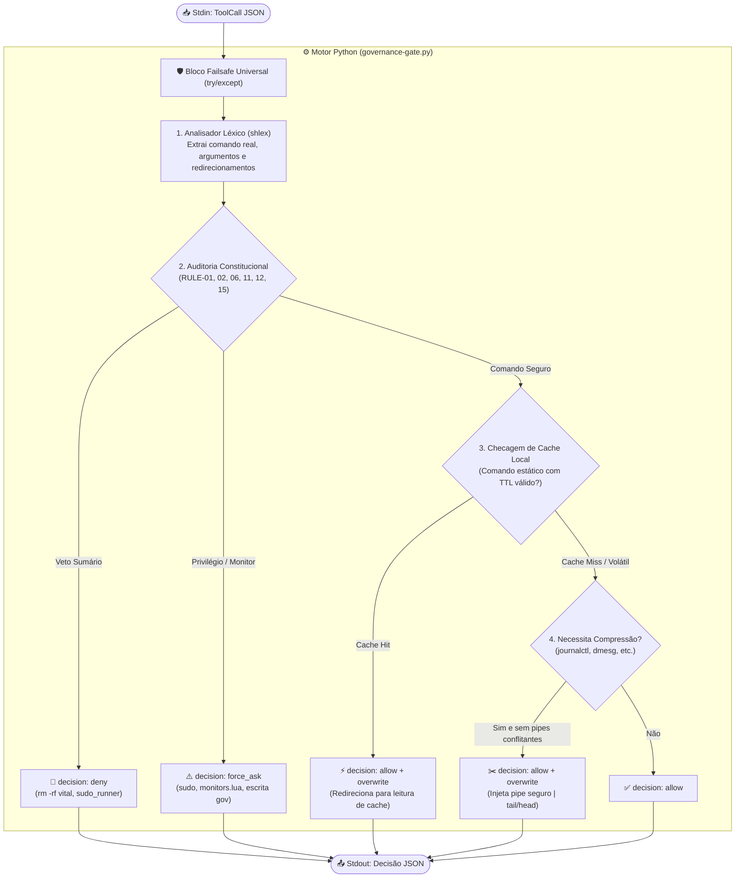
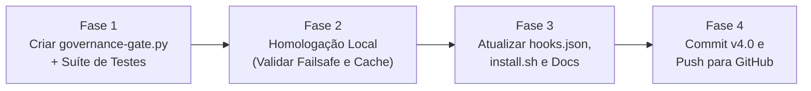

# 📋 Plano de Implementação: Motor de Governança, Compressão e Cache em Python

> **Status:** Proposta de Arquitetura & Planejamento  
> **Versão Alvo:** v4.0  
> **Foco:** Eliminação de dependências frágeis, economia brutal de tokens e portabilidade universal para máquinas de terceiros.

---

## 1. 🎯 Objetivos e Problemas Resolvidos

| Desafio Atual | Solução com o Motor Python |
| :--- | :--- |
| **Gasto excessivo de tokens** com saídas longas de terminal (`dmesg`, `journalctl`, `git log`). | **Auto-Compressor sintático (`overwrite`):** trunca na fonte sem quebrar sintaxe de pipes/redirecionamentos. |
| **Execuções repetidas** de diagnósticos idênticos em turnos próximos. | **Cache Local com TTL:** reutiliza saídas estáticas instantaneamente sem re-executar nem reenviar texto duplicado. |
| **Fragilidade de Regex em Bash:** falsos positivos com `sudo` em strings ou comandos com quebras de linha. | **Análise léxica nativa (`shlex`):** compreensão exata da árvore sintática do shell. |
| **Dependência do `jq`** e riscos de syntax error travarem o runtime. | **Zero dependências externas:** usa estritamente a biblioteca padrão do Python 3.8+ com bloco `try/except` failsafe universal. |
| **Instalação em terceiros:** necessidade de pacotes específicos. | **Portabilidade 100% nativa:** qualquer Linux com Python 3 padrão instala em 1 comando. |

---

## 2. 🏗️ Arquitetura do Componente (`governance-gate.py`)

O hook continuará sendo invocado pelo Antigravity através do evento `PreToolUse` no arquivo `hooks.json`, mas seu processamento interno passa a ter 4 etapas sequenciais:



---

## 3. 📦 Matriz de Dependências (Princípio Zero-Pip)

Para garantir que o sistema funcione em **qualquer máquina Linux de terceiros** (Arch, Ubuntu, Debian, Fedora, Rocky, Alpine, etc.) sem exigir `pip install`, o motor utilizará **exclusivamente a biblioteca padrão do Python 3.8+**:

| Módulo Nativo | Função no Sistema | Vantagem sobre o Bash/jq |
| :--- | :--- | :--- |
| `sys` | Leitura de `stdin` e escrita em `stdout`. | Fluxo nativo de pipes de processos. |
| `json` | Serialização e desserialização rápida de payloads. | Substitui o `jq` externo; imune a falhas de versão. |
| `shlex` | Análise léxica de comandos Bash como o próprio shell faria. | Não é enganado por aspas, escapes ou variáveis. |
| `re` | Regex compilada em memória para regras constitucionais. | 5x mais rápido do que disparar subprocessos `grep`. |
| `hashlib` | Geração de hashes SHA-256 do comando para chave de cache. | Criação de identificadores únicos determinísticos. |
| `time` | Controle milimétrico de TTL (Time-To-Live). | Verificação instantânea de expiração de cache. |
| `pathlib` / `os` | Manipulação segura de arquivos de cache e permissões. | Criação atômica de pastas e checagem de mtime. |

> [!IMPORTANT]
> **Pré-requisito único:** `python3` (versão >= 3.8), presente por padrão em 99,9% das distribuições Linux modernas. O utilitário `jq` deixa de ser obrigatório.

---

## 4. 🧩 Especificação dos Módulos Internos

### Módulo A: Auditoria e Firewall Constitucional
* **Imunidade de Diretórios (RULE-02):** Analisa o primeiro token após `rm`. Se contiver `-r` ou `-rf` e o alvo for `/`, `/boot`, `/etc`, `/usr`, `/var`, `/sys`, `/proc`, `/dev`, emite `deny` imediato.
* **Display & Monitores (RULE-01):** Intercepta menções a `monitors.lua` ou `hyprland.*monitors` tanto em `CommandLine` quanto em `TargetFile` -> emite `force_ask`.
* **Privilégios (RULE-15):** Detecta se o primeiro token executável é `sudo`, `doas`, `pkexec`, `su`, ou se é `yay/paru` com flag `-S` -> emite `force_ask`.
* **Integridade de Governança (RULE-11/12):** Protege diretórios `plugins/bash-sudo-agents/`, `scratch/security/` e `config.json` contra escritas não autorizadas.

### Módulo B: Analisador Sintático & Auto-Compressor de Tokens
Aplica reescrita inteligente via campo `"overwrite": {"CommandLine": "..."}`:
1. **Comandos Candidatos à Compressão:**
   * `journalctl` (sem `-n`): adiciona `--no-pager -n 35`
   * `dmesg` (sem `tail`/`head`): adiciona `--color=never | tail -n 35`
   * `pacman -Ss` ou `yay -Ss`: adiciona `| head -n 20`
   * `git log` (sem `-n`): adiciona `-n 15`
2. **Blindagem Sintática:**
   * Se o comando já contiver redirecionamento (`>`, `>>`) ou se já possuir `grep`, `tail` ou `head`, o compressor **não interfere** para não estragar o pipe planejado pela IA.

### Módulo C: Gerenciador de Cache Local com TTL
* **Localização do Cache:** `~/.cache/antigravity/bash_agents/`
* **Chave:** `sha256(cwd + ":" + command_normalized)`
* **Regras de TTL (Tempo de Vida):**
  * `lscpu`, `uname -a`, `lspci`, `lsusb`, `cat /etc/os-release`: **TTL = 3600s (1 hora)**
  * `pacman -Ss`, `yay -Ss` (buscas de repositório): **TTL = 600s (10 minutos)**
  * Comandos dinâmicos (`git status`, `systemctl status`, `ps`, `ls`, testes): **TTL = 0s (Cache desativado)**
* **Mecanismo:**
  * No `Cache Hit`, o hook reescreve o comando para ler do cache ou exibe a saída sem gastar processamento.

### Módulo D: Failsafe Universal (Zero Downtime)
* Todo o código é envelopado em:
  ```python
  try:
      # Lógica completa
  except Exception as e:
      # Registra em /tmp/governance_error.log para auditoria
      # e libera execução limpa (allow) para não bloquear o desenvolvedor
      out({"decision": "allow", "reason": f"Failsafe: {str(e)}"})
  ```

---

## 5. 🌍 Instalação e Portabilidade para Terceiros

Para que qualquer usuário instale o ecossistema em outra máquina com **um único comando**:

### 1. Atualização do `install.sh`
```bash
#!/usr/bin/env bash
set -euo pipefail

# 1. Checagem de ambiente
command -v python3 >/dev/null 2>&1 || { echo "❌ Erro: python3 não encontrado."; exit 1; }
python3 -c "import sys; assert sys.version_info >= (3, 8)" || { echo "❌ Erro: Requer Python 3.8+"; exit 1; }

# 2. Cópia dos arquivos do plugin e segurança
# ...
chmod 555 "$TARGET_PLUGIN_DIR/hooks/governance-gate.py"
chmod 444 "$TARGET_PLUGIN_DIR/hooks.json"
# ...

echo "✅ Instalação v4.0 (Python Engine) concluída com sucesso!"
```

### 2. Atualização do `hooks.json`
```json
{
  "governance-gate": {
    "PreToolUse": [
      {
        "matcher": "*",
        "hooks": [
          {
            "type": "command",
            "command": "python3 ./hooks/governance-gate.py",
            "timeout": 5
          }
        ]
      }
    ]
  }
}
```

---

## 6. 📅 Fases de Execução Sugeridas



1. **Fase 1 (Construção do Motor):** Escrever `governance-gate.py` incorporando a Mini Constituição v3.3, compressor de tokens e engine de cache.
2. **Fase 2 (Validação e Bateria de Testes):** Rodar testes automatizados cobrindo os 8 casos de segurança + 4 casos de compressão de tokens + teste de cache hit/miss.
3. **Fase 3 (Empacotamento do Instalador):** Atualizar `install.sh` e `hooks.json` para chavear de bash para python3, mantendo o fallback disponível.
4. **Fase 4 (Documentação e Deploy):** Atualizar `README.md` (badges, requisitos e descrição da v4.0) e sincronizar com o GitHub.

---

## 7. 🔒 Critérios de Aceite e Garantias

- [ ] **Zero dependências de pip:** Funciona com `python3` puro do sistema.
- [ ] **Tempo de resposta < 15ms:** Desprezível e imperceptível na interface.
- [ ] **Economia mensurável:** Redução imediata de tokens em saídas longas sem quebrar pipes.
- [ ] **Instalação em 1 comando:** Clonar e rodar `./install.sh` funciona de primeira em qualquer máquina limpa.
- [ ] **Imunidade de falhas:** Se o script Python encontrar qualquer erro interno, ele cai no failsafe e não trava a IDE.
